# EDA summary: the 10 most important findings

Data: tune (2025-04-09 … 2026-01-31) and validation (2026-02-01 … 2026-05-31) only; the test period was not
loaded. Full analysis: `notebooks/01_eda.ipynb` (executed, outputs saved). Numbers: `reports/eda_numbers.json`.

---

### 1. A quarter of the time is missing, and the 17th of each month is almost empty
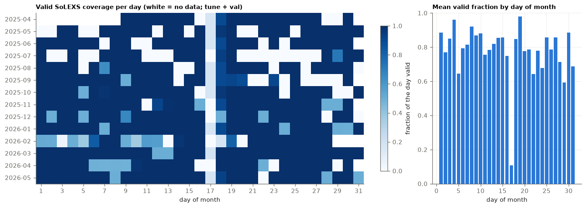

- **What we saw:** of 418 days, 331 are usable. 23.7% of minutes are missing. The 17th of every month has only about
  11% valid coverage, against about 80% on other days. 56 gaps last a day or longer (the longest is 8 days).
- **For modelling:** gaps must stay missing (never interpolated); labels use `ok` flags; a missing hour is not a
  quiet hour.

### 2. The Sun's brightness spans four orders of magnitude
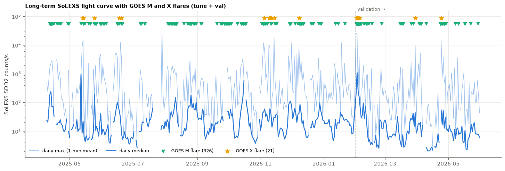

- **What we saw:** 90% of daily median counts lie between about 3.5 and 90 counts/s (5th–95th percentile), while flare peaks reach about 35,000
  counts/s. 326 M and 21 X flares occurred, clustered in one-to-two-week active-region episodes.
- **For modelling:** use log and background-relative features. Rows are strongly correlated in time, so
  confidence intervals must resample whole days, not rows.

### 3. The data are not stationary: background and flare rates drift
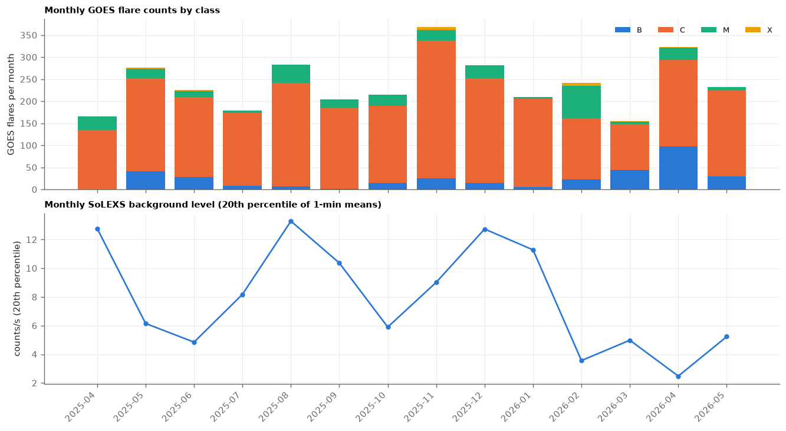

- **What we saw:** the background level fell from about 12.8 to about 5.2 counts/s between Apr 2025 and May 2026.
  Monthly GOES flare counts range from 155 to 368.
- **For modelling:** random splits would mix eras. Chronological validation (already the rule) and drift monitoring
  are needed. Ratio features are more stable than raw counts.

### 4. Bigger flares rise longer
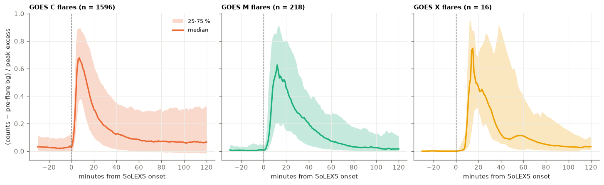

- **What we saw:** the median SoLEXS profile peaks about 7 min (C), 12 min (M) and 15 min (X) after onset, then
  decays to half within about 7–8 minutes (C, M).
- **For modelling:** a 30-minute horizon contains the whole rise. Early-rise features (slopes, short windows)
  matter for nowcasting.

### 5. SoLEXS counts track GOES flux closely, but non-linearly
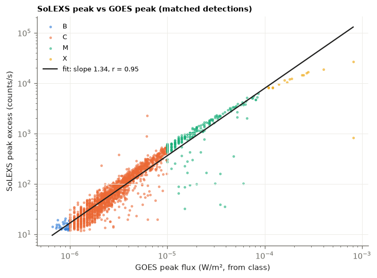

- **What we saw:** peak excess ∝ (GOES flux)^1.34, r = 0.95, over 1,905 matched events. The median event lasts
  14 min (rise 8.5 min, decay to half 4.5 min).
- **For modelling:** log features suit the relationship. Even so, GOES classes come only from GOES (project rule);
  this fit is diagnostic, not a converter.

### 6. The detector times flares well but misses small ones on a busy background
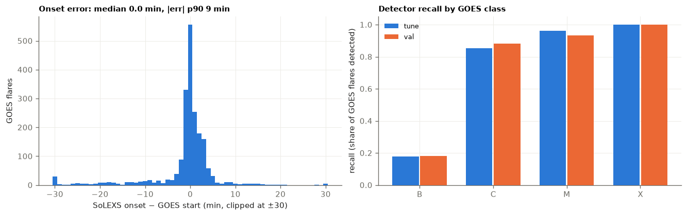

- **What we saw:** onset error median 0 min, 90th percentile 9 min. Recall: C 0.85/0.88, M 0.96/0.93, X 1.0, but
  B only 0.18 (tune/val). 292 observed C/M flares were missed, typically on a high or decaying background
  (`06_missed_examples.png`).
- **For modelling:** this justified taking forecast labels from GOES directly. The detector is used for timing and
  the activity flag.

### 7. No single feature separates "flare coming" from "no flare" on quiet rows
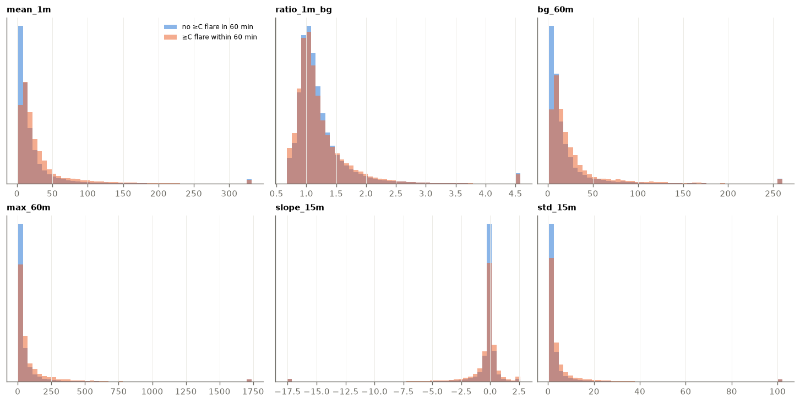

- **What we saw:** for ≥C within 60 min on quiet-start rows, the standardised median shift of every feature shown is
  at most 0.04.
- **For modelling:** expect modest forecast skill (TSS about 0.2 for C), coming from feature combinations and
  activity level. Report baselines and intervals so modest skill isn't over-claimed.

### 8. Many features are near-duplicates
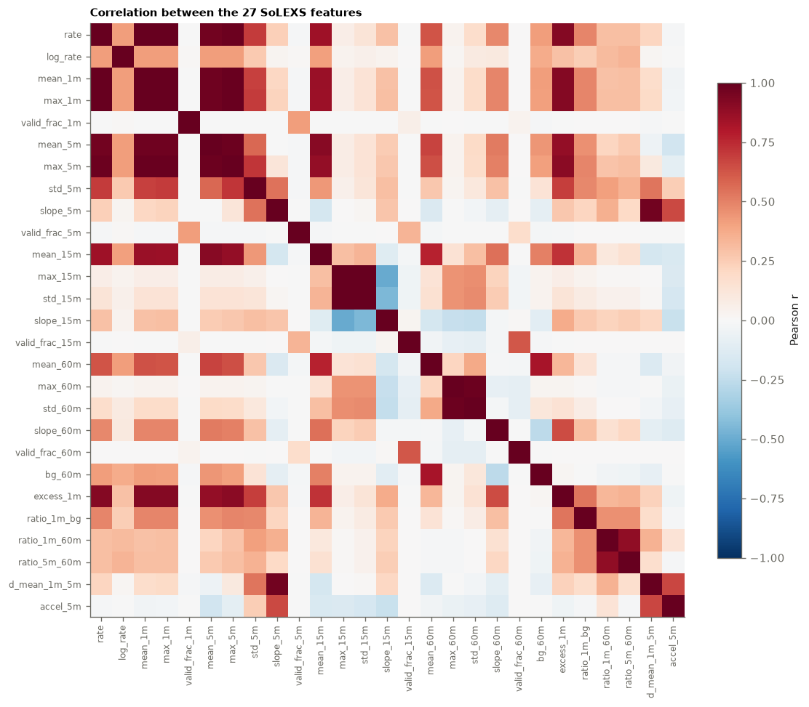

- **What we saw:** 18 pairs have |r| > 0.9. `rate`, `mean_1m` and `max_1m` correlate at r = 0.999.
- **For modelling:** harmless for XGBoost, but logistic-regression coefficients become unstable and hard to
  interpret. Dropping duplicates is a candidate simplification (future work).

### 9. Flares are rare and their rate swings tenfold month to month
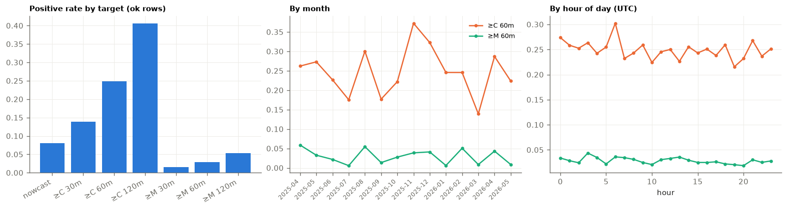

- **What we saw:**
  - Positive rates: nowcast 8%; ≥C within 30/60/120 min 14/25/41%; ≥M within 30/60/120 min 1.5/2.8/5.3%.
  - ≥M in 60 min ranges from 0.6% to 5.9% by month.
  - Hour-of-day variation (22–30% for ≥C in 60 min) probably reflects when SoLEXS observes, not physics.
- **For modelling:** M forecasting is a rare-event problem, so use TSS and HSS (never accuracy alone) plus
  baselines. Monthly swings make single-number scores fragile, which is another reason for intervals.

### 10. Hard X-rays (HEL1OS) cover only 4.7% of rows (tune 4.0%, val 6.3%), but the physics checks out
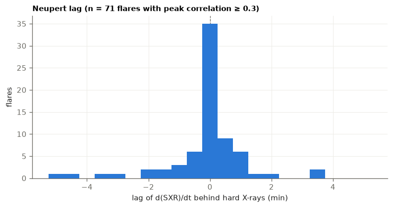 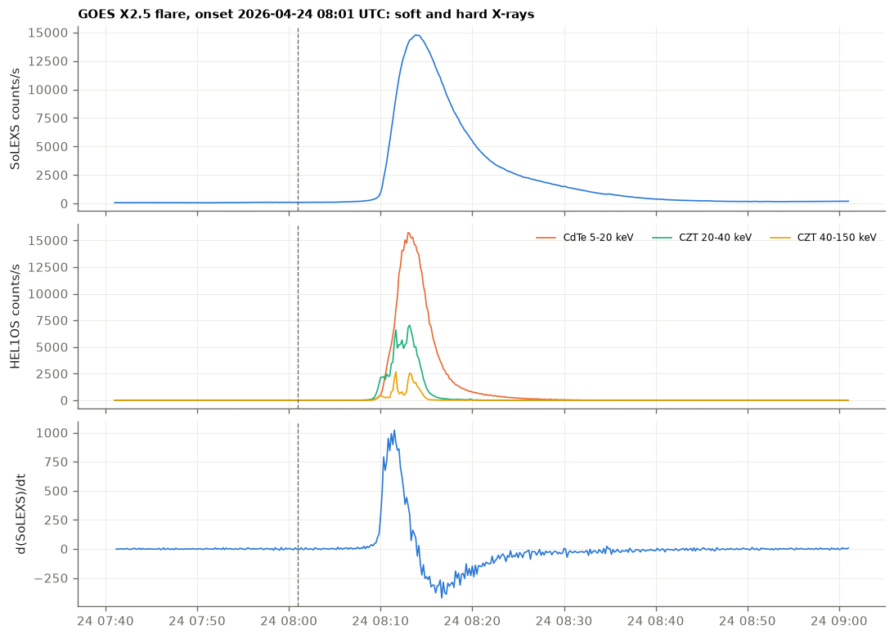

- **Overlap:** tune has 13 days / 215.6 h (GOES flares starting inside: C 75, M 27, X 0); val has 8 days / 143.5 h
  (C 70, M 14, X 2).
- **Neupert lag:** median 0 s (IQR −10 to +20 s, 71 flares). Hard X-rays peak with the soft X-ray *rise rate*, the
  Neupert effect, which also proves the two instruments' clocks are aligned.
- **Hardness ratio:** the CZT ratio falls during flares (0.68 → 0.63), because quiet-time CZT counts are dominated
  by a flat background (`09_hardness.png`).
- **For modelling:** HEL1OS can only help in its small window, and validation holds just 16 M/X flares there. A
  soft-vs-hard ablation for M targets will be underpowered and must say so.
